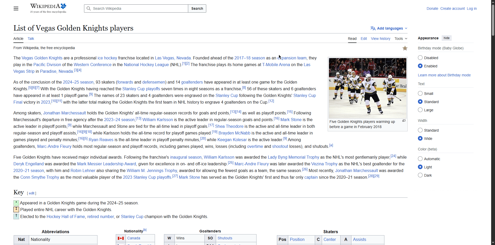
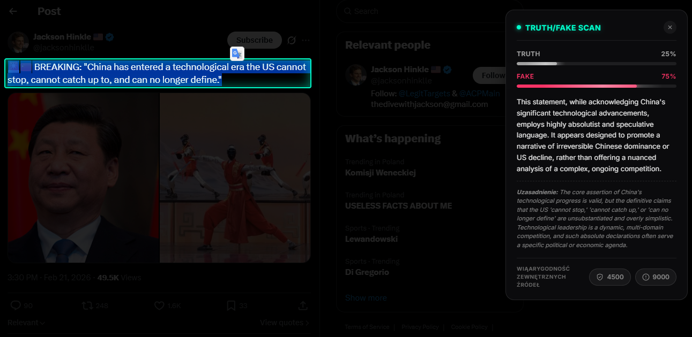
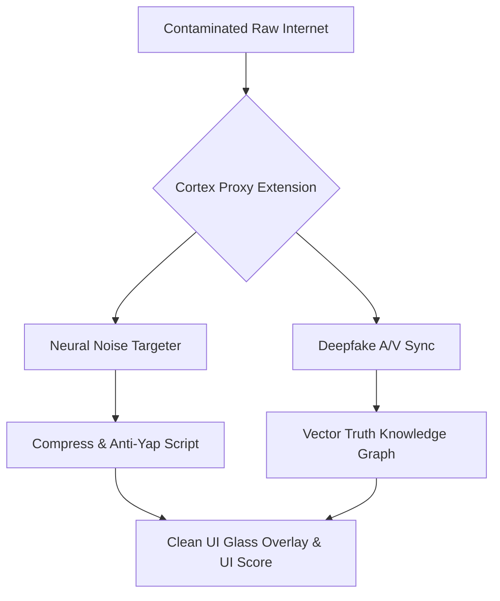

  
  <h1>🛡️ CORTEX</h1>
  <h3><i>Reality Filter Layer & Cognitive Security</i></h3>

  
<strong>"Don't just browse the web. See what's actually there."</strong>

  

    
    
    
  

  
  
🌍 <strong>Languages:</strong> <a href="README.en.md">🇺🇸 English</a> | <a href="README.md">🇵🇱 Polski</a>

   
  

## 📌 System Vision (Project "The Dead Internet")
**Cortex** is an innovative **Cognitive Security (CogSec)** layer planned as the market standard for 2026/2027. We live in a world completely dominated by synthetic media, bots, and algorithmic noise.

Most of what you see on the internet is a carefully designed illusion generated to ruin your attention span with dopamine. Cortex is your personal, ruthless guardian. It acts as a "glass" (transparent) overlay applied directly to your web browser. It filters out worthless noise in milliseconds, catches disinformation, and completely isolates your mind from the simplest manipulations of platforms like *X, Meta, TikTok, or Google*.

## ⚙️ Tech Stack (The "AntiGravity" Setup)
The tech stack was architecturally prepared for absolutely zero latency, massive stream traffic, and AI algorithm verification on the client's Edge:

| Component | Technology | Cortex Use Case |
| :--- | :--- | :--- |
| **Runtime** | `Bun` / `Rust (WASM)` | Extremely fast execution of processes without burdening or slowing down your personal browser. |
| **AI Understanding**| `Google Gemini 2.0 Flash` | Cutting-edge LLM used for the fastest deconstruction and semantic verification of analyzed posts. |
| **Network Transfer** | `gRPC over HTTP/3` | System for transferring captured micro-streams or packets directly to the validator cloud. |
| **Absolute Memory**| `Pinecone` / `Weaviate`| Vector and non-linear databases building private "Knowledge Graphs" (Truth fingerprints for quick access). |
| **Security**| `Zero-Knowledge Proofs`| Cryptographic guarantee that content scanning happens *locally* and no logins or content leave your browser directly. |

## ✨ MVP Pillar (Core Outline Features)

### 1. 🟢 Truth Overlay (Verification Pictogram)
Injecting graphical and luminous notifications into the DOM (Shadow) sandbox. Small overlays *(Truth / Vibe Score Badges)* physically appear next to other users' posts. The algorithm assesses their reality and the compressed true intent of the sender in 0.2s.

> **Live Preview (UI Concept):**
>  
> 

### 2. ⏳ Focus-Lock Mode (Receptive Key)
An algorithm with live site modification permissions. You force a specific browsing profile (e.g., "*Context: Learning Python*"). The script analyzes the site's semi-structure and aggressively removes **every** secondary element consuming attention in the background (shortcuts, unassigned notifications, side clickbaits), leaving the pure essence of the site.

### 3. 🕸️ Source Trace (Reverse Truth Gear)
A script unleashing "Source" investigations. The bot uses vector graphs to trace the history of a story provided by someone on X back to absolute zero. It detects whether the news originated organically from an expert or was artificially cloned from troll farms.

---

## 🚀 Logic Architecture of the "Truth" Engine
Stream blocking proxy model:

## 🔒 License and Privacy Status
The repository is strictly **Private**. `All Rights Reserved`. The core code, API keys, and plugin structure are not subject to external modifications unless assigned the status of an Authorized AntiGravity Developer.
