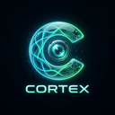
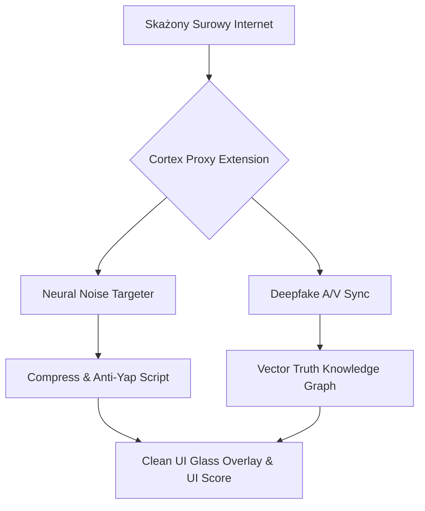

  
  <h1>🛡️ CORTEX</h1>
  <h3><i>Reality Filter Layer & Cognitive Security</i></h3>

  
<strong>"Don't just browse the web. See what's actually there."</strong>

  

    
    
    
  

  
🌍 <strong>Languages:</strong> <a href="README.en.md">🇺🇸 English</a> | <a href="README.md">🇵🇱 Polski</a>

## 📌 O wizji systemu (Projekt "The Dead Internet")
**Cortex** to innowacyjna warstwa **Cognitive Security (CogSec)** zaplanowana jako rynkowy standard na lata 2026/2027. Żyjemy w świecie całkowicie zdominowanym przez syntetyczne media, boty i szum algorytmiczny. 

Większość tego, co widzisz w internecie, to starannie zaprojektowana iluzja wygenerowana w celu zrujnowania Twojej uwagi dopaminą. Cortex to Twój osobisty, bezwzględny strażnik. Działa jako "szklana" (przezroczysta) nakładka nałożona bezpośrednio na przeglądarkę internetową. Odfiltrowuje w milisekundach bezwartościowy szum, wyłapuje dezinformacje i całkowicie izoluje Twój umysł od najprostszych manipulacji takich platform jak *X, Meta, TikTok czy Google*.

## ⚙️ Tech Stack (The "AntiGravity" Setup)
Stos technologiczny został architektonicznie przygotowany pod absolutnie zerowe opóźnienia, potężny ruch strumieniowy i weryfikację algorytmami AI na Edge'u klienta:

| Komponent | Technologia | Zastosowanie w Cortex |
| :--- | :--- | :--- |
| **Runtime** | `Bun` / `Rust (WASM)` | Ekstremalnie szybkie wykonywanie procesów bez obciążania i spowalniania Twojej osobistej przeglądarki. |
| **Rozumienie AI**| `Google Gemini 2.0 Flash` | Bardzo nowoczesne LLM użyte do najszybszej dekonstrukcji i weryfikacji semantycznej analizowanych postów. |
| **Przesył Sieci** | `gRPC over HTTP/3` | System przesyłu wyłapanych mikro-strumieni lub pakietów wprost do chmury walidatora. |
| **Pamięć Absolutna**| `Pinecone` / `Weaviate`| Wektorowe i nieliniowe bazy danych budujące prywatne "Grafy Wiedzy" (Odciski Palców prawdy dla szybkiego dostępu). |
| **Bezpieczeństwo**| `Zero-Knowledge Proofs`| Gwarancja (kryptograficzna), że skanowanie zawartości odbywa się *lokalnie* i żadne loginy lub treści wprost nie wychodzą z Twojej przeglądarki. |

## ✨ Filar MVP (Funkcje Zarysu Głównego)

### 1. 🟢 Truth Overlay (Piktogram Weryfikacji)
Wstrzykiwanie w "piaskownicy" DOM (Shadow) graficznych i świetlistych powiadomień. Małe nakładki *(Truth / Vibe Score Badges)* pokazują się fizycznie obok postów innych użytkowników. Algorytm w 0.2s ocenia ich realność i skompresowany prawdziwy zamiar nadawcy. 

### 2. ⏳ Focus-Lock Mode (Klucz Receptywny)
Algorytm z uprawnieniami modyfikacji witryny live. Wymuszasz dany profil przeglądania (np. "*Kontekst: Nauka Pythona*"). Skrypt analizuje semistrukturę serwisu i w tle agresywnie usuwa **każdy** poboczny element pożerający uwagę (tzw. shorciki, nieprzyporządkowane notyfikacje, clickbaity na boku), zostawiając czystą esencję serwisu.

### 3. 🕸️ Source Trace (Bieg Wsteczny Prawdy)
Skrypt uwalniający śledztwa "Source". Bot używa grafów wektorowych by cofnąć bieg podanej przez kogoś historii na X aż do absolutnego zera. Wykrywa, czy news wyleciał organicznie od eksperta, czy sztucznie sklonowano go z farm trolli.

---

## 🚀 Architektura Logiczna Silnika "Prawdy"
Model strumieniowego blokowania:

## 🔒 Status Licencji i Prywatności
Repozytorium jest ściśle **Prywatne**. `All Rights Reserved`. Kod rdzenia, klucze API oraz struktura wtyczki nie podlegają modyfikacjom zewnętrznym, chyba że przypisano status Autoryzowanego Dewelopera AntiGravity.
