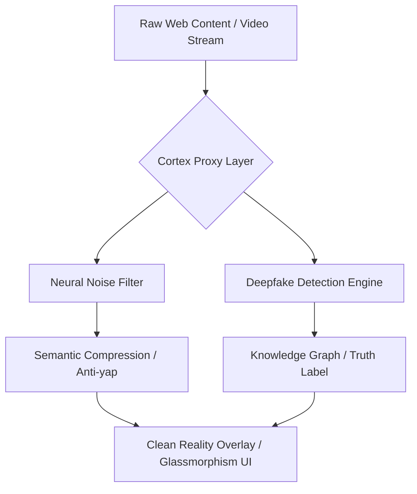

  <h1>🛡️ CORTEX (Reality Filter Layer)</h1>
  
<strong>"Don't just browse the web. See what's actually there."</strong>

## 📌 O wizji systemu
**Cortex** to innowacyjna warstwa **Cognitive Security (CogSec)**. W świecie całkowicie zdominowanym przez syntetyczne media, boty i szum The Dead Internet, Cortex działa jako bezlitosny weryfikator prawdy. Odfiltrowuje w milisekundach bezwartościowy szum informacyjny, wyłapuje generowane dezinformacje i izoluje umysł użytkownika od manipulacji algorytmów na najpopularniejszych platformach społecznościowych.

**Target operacyjny:** 2026/2027 Web Intelligence Standard.

## ⚙️ Tech Stack (The "AntiGravity" Setup)
Stos ukierunkowany pod maksymalną szybkość na Edge'u i streaming danych:

* **Runtime:** `Bun` / `Rust (WASM)` – Ekstremalnie szybkie wykonywanie procesów wewnątrz V8 (przeglądarce).
* **AI Processing:** `Google Gemini 2.0 / Flash` – Gwarancja najniższego *latency* przy dekonstrukcji i weryfikacji semantycznej.
* **Real-time Stream:** `gRPC over HTTP/3` – Błyskawiczny przepływ metadanych strumieni A/V.
* **Vector DB:** `Pinecone` / `Weaviate` – Przechowywanie lokalnych grafów wiedzy oraz "odcisków palców" zatwierdzonych źródeł.
* **Privacy (Local-first):** `Zero-Knowledge Proofs (ZKP)` – Zapewnienie analizy prawdy bez eksportowania ciasteczek, tożsamości czy danych użytkownika poza maszynę hosta!

## ✨ Moduły Startowe (MVP)
- **Truth Overlay** (Główna misja)
  Wstrzykiwanie w bezpieczny sposób wewnątrz DOM autorskich powiadomień i ikon (Truth/Vibe Score Badge) oceniających prawdziwość wyciągniętych postów czy nagłówków (X, Meta, Google).
- **Focus-Lock Mode** (Śluza Uwagi)
  Dynamiczny skrypt modyfikacyjny usuwający asynchronicznie wszystkie komponenty sieci nie korelujące twardo ze zdefiniowanym obecnie *Kontekstem użytkowania* (np. usunięcie shortów w trybie nauki).
- **Source Trace** (Śledztwo na żywo)
  Skrypt automatyzujący inżynierię wsteczną propagacji: skąd dany news wypłynął, weryfikacja wzorców farmienia trolli.

## 🚀 Architektura Koncepcyjna

## 🔌 Instalacja dla Deweloperów
*(Sekcja w trakcie przygotowywania na etapie konfiguracji manifestu i silników Gemini API).*
