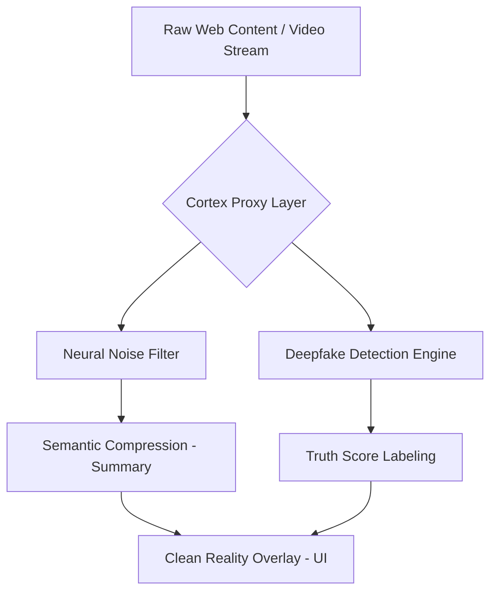

# 🛡️ Project: CORTEX (Reality Filter Layer)

**Target:** 2026/2027 Web Intelligence Standard  
**Environment:** Google AntiGravity / Vertex AI / Edge Mesh

## 1. Core Mission Statement

Cortex to warstwa Cognitive Security (CogSec). W świecie zdominowanym przez syntetyczne media, Cortex weryfikuje prawdę w milisekundach, odfiltrowuje szum informacyjny i chroni uwagę użytkownika przed manipulacją AI.

## 2. Tech Stack (The "AntiGravity" Setup)

Do budowy tego potwora potrzebujesz technologii, które poradzą sobie z analizą strumieniową w czasie rzeczywistym:

| Layer | Technology | Why? |
| :--- | :--- | :--- |
| **Runtime** | Bun / Rust (WASM) | Ekstremalna szybkość na Edge'u (przeglądarka). |
| **AI Processing** | Google Gemini 2.0 / Flash | Najniższe latency dla analizy semantycznej. |
| **Real-time Stream** | gRPC over HTTP/3 | Błyskawiczne przesyłanie metadanych wideo/audio. |
| **Vector DB** | Pinecone / Weaviate | Przechowywanie "odcisków palców" prawdy (Knowledge Graphs). |
| **Privacy** | Zero-Knowledge Proofs (ZKP) | Analiza treści bez wysyłania prywatnych danych na serwer. |

## 3. High-Level Architecture (Copy-Paste Logic)

## 4. MVP Feature List (Co musisz zakodzić najpierw)

- **Truth Overlay:** Wstrzykiwanie małych ikon (Badge) obok tekstów/wideo na stronach typu X, Facebook czy YouTube, informujących o "Vibe/Truth Score".
- **Focus-Lock Mode:** Skrypt usuwający z DOM wszystkie elementy, które nie pasują do aktualnie wybranego "Contextu" (np. tryb "Nauka programowania").
- **Source Trace:** Funkcja "skąd to się wzięło?" – AI szuka pierwotnego źródła danej informacji, by sprawdzić, czy nie zaczęła się od bota na farmie trolli.

## 5. First Steps (Twoja "To-Do" Lista)

- [ ] **Inicjalizacja:** Postawienie środowiska na Google Cloud / AntiGravity z wykorzystaniem Cloud Run dla mikroserwisów analizy.
- [ ] **Extension Scaffold:** Stworzenie rozszerzenia przeglądarki (Manifest V3/V4), które przechwytuje tekst ze strony.
- [ ] **Model Connection:** Połączenie się z API Gemini do szybkiego tagowania treści (Sentiment & Fact-Check).
- [ ] **UI Concept:** Zaprojektowanie "Huda" (interfejsu), który wygląda jak minimalistyczna warstwa nałożona na internet (Glassmorphism, neonowe akcenty).

## 6. Slogan Marketingowy na 2027:

> "Don't just browse the web. See what's actually there."